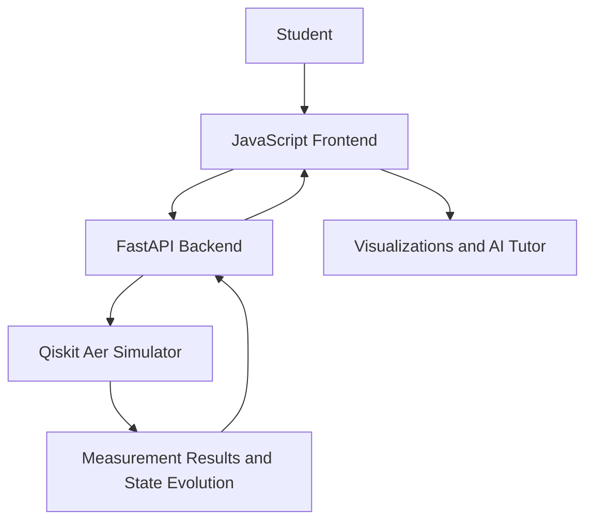

<div align="center">

# Veda

**VTU-QFF-HC-0001** | **Tier: Online**

# Green Quanta — AI Quantum Learning Platform

An interactive platform that helps students learn quantum computing through circuit building, simulation, visualizations, quizzes, and AI-assisted explanations.

[Live Website](https://green-quanta-ai-sigj.onrender.com) · [Demo Video](https://youtu.be/OYJ-GzHXSsI) · [GitHub Repository](https://github.com/vtu-qiskit-fall-fest-2026/vtu-hc-veda)

</div>

---

## 📌 Hackathon Details

| Field | Details |
|---|---|
| Team Name | Veda |
| Team ID | VTU-QFF-HC-0001 |
| Event | VTU-Qiskit Fall Fest 2026 |
| Tier | Online |
| Track | Track 4 — Quantum + AI & ML |
| Project | Green Quanta — AI Quantum Learning Platform |

---

## 👥 Team Members

| # | Name | GitHub Username | Role |
|---|---|---|---|
| 1 | Darshan Naik | [darshannaik0915](https://github.com/darshannaik0915) | Team Lead |
| 2 | Amol | [amolkalate86](https://github.com/amolkalate86) | Developer |
| 3 | Payal | [payalvn07-lang](https://github.com/payalvn07-lang) | Developer |

---

## ❓ Problem Statement

Quantum computing is difficult for beginners to learn because concepts such as qubits, superposition, quantum gates, and measurement are often taught theoretically without enough hands-on experimentation. Students need an accessible way to build quantum circuits, simulate their behaviour, and understand how quantum states change after each gate.

### Why It Matters

Interactive learning can make quantum computing more understandable and engaging. Visualizing circuit outputs and step-by-step state evolution helps learners connect quantum theory with practical experiments.

**Track / Category:** Online — Track 4: Quantum + AI & ML

---

## 💡 Proposed Solution

Green Quanta is an AI-assisted quantum learning platform designed to make quantum computing easier to explore through interactive learning tools. Learners can explore concepts, build quantum circuits, examine simulation results, practise with quizzes, track learning progress, and use an AI tutor for explanations.

### Key Features

- **Dashboard:** A central place to access learning tools.
- **Quantum Learning:** Explore quantum computing concepts.
- **Circuit Builder:** Create circuits using quantum gates.
- **Quantum Simulator:** Explore circuit measurement results and state behaviour.
- **Algorithms:** Learn about quantum algorithm concepts.
- **AI Tutor:** Get explanations and learning assistance.
- **Quizzes:** Practise concepts and test understanding.
- **Progress Tracking:** Review learning activity.
- **Profile and Settings:** Manage available account preferences.

*Features depend on the current implementation of the deployed application.*

---

## 🧩 Approach & Architecture

The platform connects the learner-facing interface with backend services and quantum simulation components.



### Workflow

1. **Input:** The learner selects qubits and adds gates such as H, X, or CNOT.
2. **Frontend:** The interface displays the circuit and available controls.
3. **Quantum Core:** The backend processes circuit requests using the configured quantum simulator.
4. **Simulation:** The simulator produces results for the requested circuit.
5. **Output:** Learners examine available measurement results, visualizations, and explanations.

---

## 🛠️ Tech Stack

| Layer | Technology |
|---|---|
| Programming Languages | Python, JavaScript |
| Quantum SDK | Qiskit |
| Quantum Simulation | Qiskit Aer |
| Backend Framework | FastAPI |
| Frontend | HTML, CSS, JavaScript |
| Database | Configured database, if enabled |
| Development Tools | VS Code, Git, GitHub |
| Deployment | Render |

*Refer to the source code and dependency files for the exact technologies and versions used.*

---

## 📁 Project Structure

```text
vtu-hc-veda/
├── README.md
├── requirements.txt
├── main.py
├── db.py
├── models.py
├── supabase_schema.sql
├── index.html
├── frontend/
├── js/
├── quantum/
├── .env.example
├── .gitignore
├── IMPLEMENTATION_PLAN.md
├── LICENSE
└── veda.pptx
```

This is a high-level overview. The actual repository may contain additional files and directories.

---

## 🚀 How to Run

### Prerequisites

- Python 3.11 or a compatible version
- Git
- A GitHub account with repository access

### 1. Clone the Repository

```bash
git clone https://github.com/vtu-qiskit-fall-fest-2026/vtu-hc-veda.git
cd vtu-hc-veda
```

### 2. Create a Virtual Environment

```bash
python -m venv .venv
```

**Windows:**

```bash
.venv\Scripts\activate
```

**macOS / Linux:**

```bash
source .venv/bin/activate
```

### 3. Install Dependencies

```bash
pip install -r requirements.txt
```

### 4. Configure Environment Variables

If required, configure local environment variables using `.env.example` as a reference. Do not commit API keys, passwords, or other secrets.

### 5. Start the Application

For a FastAPI application whose entry point is `main.py` and whose application object is named `app`, use:

```bash
uvicorn main:app --reload
```

If the project defines a different start command, use the command specified in its application configuration.

---

## 🌐 Project Links

- **Live Website:** https://green-quanta-ai-sigj.onrender.com
- **Demo Video:** https://youtu.be/OYJ-GzHXSsI
- **Hackathon Repository:** https://github.com/vtu-qiskit-fall-fest-2026/vtu-hc-veda
- **Original Project Repository:** https://github.com/darshannaik0915/green-quanta-ai

---

## ✅ Submission Checklist

- [ ] README updated with project details.
- [ ] Team name, Team ID, and members listed.
- [ ] Source code committed to the repository.
- [ ] Dependencies and setup instructions checked.
- [ ] Live website tested.
- [ ] Demo video link tested.
- [ ] Presentation uploaded as `veda.pptx`.
- [ ] Required collaborator invitations accepted.
- [ ] Official submission form or portal completed, if required.

---

## 📚 Resources

- [Qiskit Documentation](https://docs.quantum.ibm.com/)
- [Qiskit Aer Simulator](https://docs.quantum.ibm.com/guides/simulate)
- [IBM Quantum Platform](https://quantum.ibm.com/)
- [Qiskit Learning Resources](https://qiskit.qotlabs.org/learning)
- [GitHub Documentation](https://docs.github.com/)

---

## 📄 License

Refer to the repository's `LICENSE` file for the applicable license terms.

---

<div align="center">

**Veda** · `VTU-QFF-HC-0001`

VTU-Qiskit Fall Fest 2026  
**Track 4 — Quantum + AI & ML**
Project Links

- Live Website: https://green-quanta-ai-sigj.onrender.com
- Demo Video: https://youtu.be/0YJ-GzHXsSI?si=MUuf7v1MvzwFRSmD
- GitHub Repository: https://github.com/vtu-qiskit-fall-fest-2026/vtu-hc-veda

[Visit the Live Website](https://green-quanta-ai-sigj.onrender.com)

</div>
