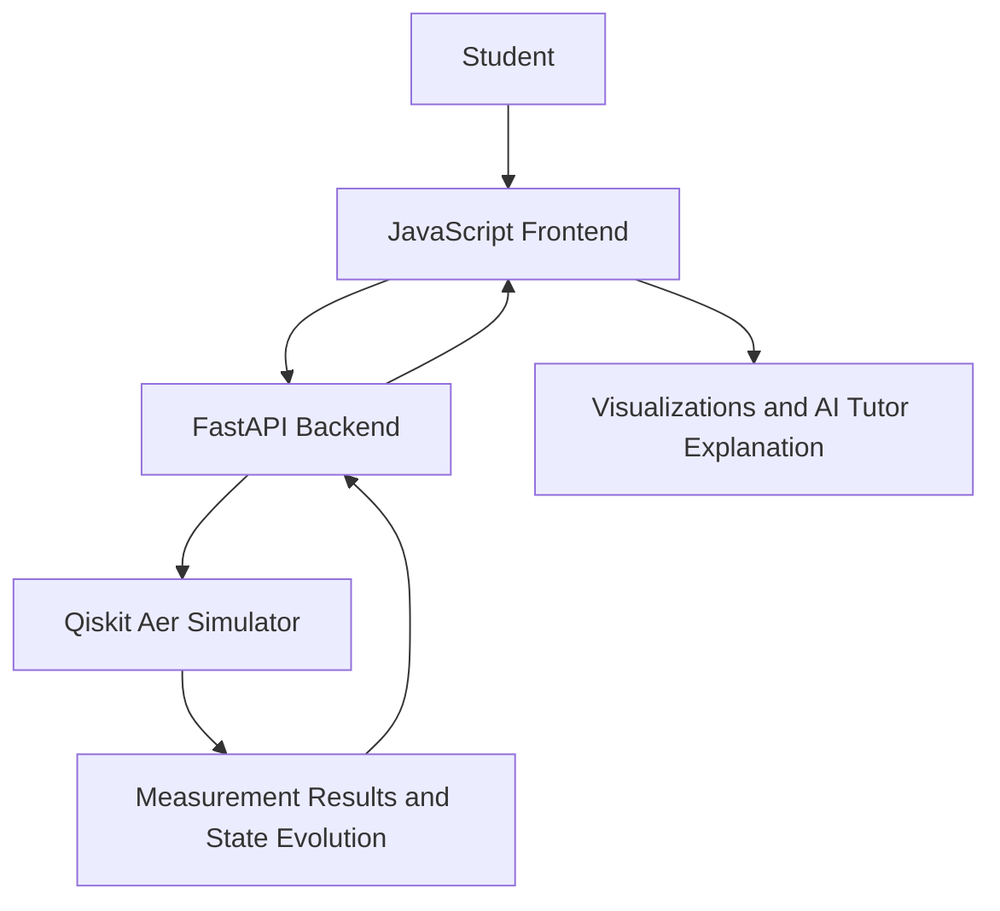

<div align="center">

# Veda

**VTU-QFF-HC-0001** &nbsp;|&nbsp; Tier: **Online**

</div>

---

<div align="center">

| | |
| :--- | :--- |
| **Team** | Veda |
| **Team ID** | VTU-QFF-HC-0001 |
| **Tier** | Online |
| **Repository** | [vtu-hc-veda](https://github.com/vtu-qiskit-fall-fest-2026/vtu-hc-veda.git) |
| **Organisation** | [vtu-qiskit-fall-fest-2026](https://github.com/vtu-qiskit-fall-fest-2026) |
| **Event** | VTU-QFF Hackathon — VTU-Qiskit Fall Fest 2026 |

</div>

---

## 📌 Table of Contents

- [Team Members](#-team-members-github-ids)
- [Problem Statement](#-problem-statement)
- [Proposed Solution](#-proposed-solution)
- [Approach & Architecture](#-approach--architecture)
- [Tech Stack](#-tech-stack)
- [Project Structure](#-project-structure)
- [How to Run](#-how-to-run)
- [How to Push Code](#-how-to-push-code)
- [Submission Checklist](#-submission-checklist)
- [Resources](#-resources)
- [License](#-license)

---

## 👥 Team Members (GitHub IDs)

> Members are added to this repository as **collaborators** and must accept the
> GitHub invitation before they can push. Add your GitHub username below.

| # | Name | GitHub Username | Role |
| :-- | :--- | :--- | :--- |
| 1 | Darshan Naik | darshannaik0915 | Team Lead |
| 2 | Amol | amolkalate86 | Developer |
| 3 | Payal | payalnaik07-lang | Developer |

<!--
Optional: add a plain list instead of the table above.
- @username1
- @username2
-->

---

## ❓ Problem Statement

<!--
State the problem you are solving. Be specific: what is broken or missing,
who experiences it, and why does it matter. Link to the official problem
statement from the brief if one applies.
-->

**Problem:** Quantum computing is difficult for beginners to learn because concepts such as qubits, superposition, quantum gates, and measurement are often taught theoretically without enough hands-on experimentation. Students need an accessible way to build quantum circuits, simulate their behaviour, and understand how quantum states change after each gate.

**Why it matters:** Interactive learning can make quantum computing more understandable and engaging for students. Visualizing circuit outputs and step-by-step state evolution helps learners connect quantum theory with practical experiments.

**Track / Category:** Online · Track 4: Quantum + AI & ML

---

## 💡 Proposed Solution

<!--
Describe your solution. Keep it concrete: the core idea, the user flow, and
the quantum/ML technique you are applying.
-->

**Solution:** Green Quanta is an interactive quantum learning web application that lets beginners build circuits, simulate quantum gates using Qiskit Aer, visualize measurement outcomes, and explore quantum state changes step by step. It also includes lessons, quizzes, progress tracking, and an AI Tutor for explaining quantum concepts.

**Key idea:** Combine Qiskit-based circuit simulation with gate-by-gate quantum state visualization and AI-assisted explanations in one learning platform.

**Why this works:** Learners can experiment with quantum gates and observe how circuit operations affect simulated states and measurement probabilities, helping them connect theoretical concepts with practical results.

---

## 🧩 Approach & Architecture

<!--
Walk through how it works. A simple pipeline diagram in text or Mermaid is ideal.
-->



1. **Input:** The learner selects qubits and adds H, X, or CNOT gates.
2. **Frontend:** JavaScript displays the circuit builder and simulation results.
3. **Quantum core:** FastAPI sends circuit requests to the Qiskit Aer simulator.
4. **Post-processing:** Simulation results include measurement counts and state information.
5. **Output:** Learners explore circuit results, state evolution, and tutor explanations.
---

## 🛠️ Tech Stack

| Layer | Technology |
| :--- | :--- |
| Frontend | HTML, CSS, JavaScript |
| Backend | Python, FastAPI, Uvicorn |
| Quantum SDK | Qiskit |
| Simulation | Qiskit Aer |
| Database | Supabase / PostgreSQL |
| API Communication | REST API, JSON |
| Deployment | Render |
| Version Control | Git, GitHub |
---

## 📁 Project Structure

```text
GOAT/
├── README.md
├── requirements.txt
├── .gitignore
├── .env.example
├── supabase_schema.sql
├── backend/
│   ├── __init__.py
│   ├── main.py
│   ├── db.py
│   ├── models.py
│   └── quantum/
│       ├── __init__.py
│       ├── simulator.py
│       ├── time_machine.py
│       └── tutor.py
└── frontend/
    ├── index.html
    ├── css/
    │   └── style.css
    └── js/
        ├── circuitBuilder.js
        ├── simulator.js
        ├── timeMachine.js
        ├── tutor.js
        └── main.js
```

---

## 🚀 How to Run


### Prerequisites

- Python 3.11 or newer
- Git
- A web browser

### 1. Clone the repository

```bash
git clone https://github.com/vtu-qiskit-fall-fest-2026/vtu-hc-veda.git
cd vtu-hc-veda
```

### 2. Create a virtual environment

```bash
python -m venv .venv
```

Windows:
```bash
.venv\Scripts\activate
```

Linux/macOS:
```bash
source .venv/bin/activate
```

### 3. Install dependencies

```bash
pip install -r requirements.txt
```

### 4. Configure environment variables

If the application requires environment variables, create a `.env` file using `.env.example` as a guide. Never commit secrets or API keys.

### 5. Run the backend

```bash
uvicorn backend.main:app --reload --port 8000
```

### 6. Open the application

Open the frontend using the serving method configured in the project. If the backend serves the frontend, visit:

`http://127.0.0.1:8000`

API health check:

`http://127.0.0.1:8000/api/health`

```

---

## 🔁 How to Push Code

> Full walkthrough: **[Git & Collaboration Handbook](../vtu-hc-guide-git-and-collaboration)** — collaboration
> workflow, branches, pull requests, reviews and conflict resolution.

### Configure Git (first time only)

```bash
git config --global user.name  "Your Name"
git config --global user.email "you@example.com"
```

### Everyday workflow

```bash
# 1. Get the latest changes
git checkout main
git pull origin main

# 2. Create a branch for your work
git checkout -b feature/my-task

# 3. Commit your work
git add .
git commit -m "feat: add variational circuit for the search problem"

# 4. Push the branch
git push -u origin feature/my-task

# 5. Open a Pull Request on GitHub and request a review
#    https://github.com/vtu-qiskit-fall-fest-2026/vtu-hc-veda/compare/main...feature/my-task

# 6. After approval, merge into main
git checkout main
git pull origin main
git branch -d feature/my-task
```

### Commit message convention

| Prefix | Meaning |
| :--- | :--- |
| `feat:` | New feature |
| `fix:` | Bug fix |
| `docs:` | Documentation only |
| `test:` | Adding or fixing tests |
| `refactor:` | Code restructure, no behaviour change |
| `chore:` | Build/config/dependency changes |

### Useful commands

```bash
git status              # what changed
git log --oneline -10   # recent commits
git diff                # review changes before committing
git stash               # shelve changes temporarily
git pull --rebase       # update your branch on top of main
```

### Collaborating on the same repo

- **Never push directly to `main`** — open a Pull Request.
- **Pull before you push** to avoid rejected commits.
- **Commit often** with clear messages.
- **Resolve conflicts** locally: `git pull --rebase`, fix the files, then `git add` + `git rebase --continue`.
- **Ask for a review** before merging — a second pair of eyes catches bugs fast.

---

## ✅ Submission Checklist

- [ ] Repository created and **public**
- [ ] All team members added as **collaborators** and invitations accepted
- [ ] `README.md` updated with project details, problem statement and solution
- [ ] Team members listed under [Team Members](#-team-members-github-ids)
- [ ] `requirements.txt` committed and project runs from a clean clone
- [ ] Code pushed to `main` and the latest `main` builds successfully
- [ ] Notebooks committed with **cleared outputs** (or use `nbstrip`)
- [ ] `README` includes a demo screenshot / video link
- [ ] Short project summary submitted on the hackathon portal

---

## 📚 Resources

| Resource | Link |
| :--- | :--- |
| 🔁 Git & collaboration handbook | [Git & Collaboration Handbook](../vtu-hc-guide-git-and-collaboration) |
| ❓ Problem statements, solutions & terms | [Problem Statements, Solutions & Terms](../vtu-hc-guide-problem-and-solution) |
| 📄 README writing guide | [README Guide & Template](../vtu-hc-guide-readme-template) |
| ⚛️ Qiskit documentation | https://docs.quantum.ibm.com/ |
| ⚛️ Qiskit Runtime & primitives | https://quantum.cloud.ibm.com/docs/ |
| 🧪 Qiskit Aer simulator | https://docs.quantum.ibm.com/guides/simulator |
| 💻 IBM Quantum Platform | https://quantum.cloud.ibm.com/ |
| 🎓 Qiskit textbook | https://qiskit.qotlabs.org/learning/ |
| 📋 GitHub Docs | https://docs.github.com/ |

---

## 📄 License

Released under the [MIT License](LICENSE). See `LICENSE` for details.

---

<div align="center">

**Veda** · Team ID `VTU-QFF-HC-0001` · Tier `Online`
· Built with ⚛️ Qiskit for the VTU-QFF Hackathon

[⬆ Back to Top](#veda)

</div>
